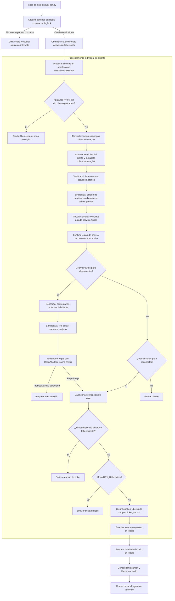

# ConnexMonitor 🤖📡

**ConnexMonitor** es un sistema automatizado para proveedores de servicios de telecomunicaciones e Internet (ISP). Se encarga de auditar continuamente la facturación de clientes en **Ubersmith**, verificar la existencia de contratos y deudas vencidas, validar promesas de pago o prórrogas mediante **Inteligencia Artificial (OpenAI)**, y generar de forma controlada tickets de soporte para la **desconexión** o **reconexión** de circuitos y servicios.

---

## 📑 Índice de Contenidos

1. [Visión General](#-visión-general)
2. [Arquitectura del Proyecto](#-arquitectura-del-proyecto)
3. [Flujo de Funcionamiento Paso a Paso](#-flujo-de-funcionamiento-paso-a-paso)
4. [Reglas de Negocio y Criterios de Decisión](#-reglas-de-negocio-y-criterios-de-decisión)
5. [Integraciones y Peticiones Externas](#-integraciones-y-peticiones-externas)
   - [Ubersmith API 2.0](#1-ubersmith-api-20)
   - [OpenAI API](#2-openai-api)
6. [Información Recolectada](#-información-recolectada)
7. [Persistencia y Almacenamiento (Redis y Ubersmith)](#-persistencia-y-almacenamiento-redis-y-ubersmith)
   - [Estructura de Claves en Redis](#estructura-de-claves-en-redis)
   - [Creación de Tickets en Ubersmith](#creación-de-tickets-en-ubersmith)
8. [Mecanismos de Resiliencia y Seguridad](#-mecanismos-de-resiliencia-y-seguridad)
9. [Instalación y Puesta en Marcha](#-instalación-y-puesta-en-marcha)
10. [Configuración de Variables de Entorno](#-configuración-de-variables-de-entorno)
11. [Modos de Uso y Comandos CLI](#-modos-de-uso-y-comandos-cli)

---

## 🔭 Visión General

El bot opera en ciclos periódicos y sustituye la revisión manual de cartera vencida:
* **Evalúa circuito por circuito** (servicios recurrentes identificados por su `service_id` o `packid`), evitando cortar líneas no relacionadas.
* **Diferencia clientes con y sin contrato**, aplicando umbrales de tolerancia diferenciados.
* **Previene cortes accidentales:** Un agente de IA lee los últimos comentarios registrados por operadores humanos y detecta prórrogas o acuerdos de pago vigentes.
* **Controla el ciclo de vida del ticket:** Rastrea en Redis las solicitudes enviadas hasta que el personal técnico o de operaciones cierra el ticket en Ubersmith.

---

## 🏗 Arquitectura del Proyecto

```
ConnexMonitor/
├── core/
│   ├── __init__.py
│   ├── bot.py                 # Orquestador del flujo, concurrencia y reglas de negocio
│   ├── ubersmith_client.py    # Cliente HTTP para la API 2.0 de Ubersmith con paginación adaptativa
│   ├── ticket_store.py        # Capa de almacenamiento y caché sobre Redis (candados, circuitos, estados)
│   └── openai_analyzer.py     # Anonimizador de PII y auditor semántico de comentarios con OpenAI
├── ignored_services.json      # Lista negra de IDs de servicios excluidos de evaluación
├── docker-compose.yml         # Contenedor de Redis listo para producción/desarrollo
├── requirements.txt           # Dependencias de Python
├── run_bot.py                 # Script de entrada para ejecución continua o en modo manual
├── .env.example               # Plantilla de variables de entorno con valores recomendados
└── README.md                  # Documentación del proyecto
```

### Componentes Principales

| Archivo / Módulo | Responsabilidad |
| :--- | :--- |
| [`run_bot.py`](file:///home/edgar/Proyectos/python/ConnexMonitor/run_bot.py) | Maneja argumentos de línea de comandos (`--once`, `--max-clients`, etc.), bucle de tiempo y logging inicial. |
| [`core/bot.py`](file:///home/edgar/Proyectos/python/ConnexMonitor/core/bot.py) | Clase principal `ConnexBot`. Coordina la concurrencia (`ThreadPoolExecutor`), sincronización de circuitos, reglas financieras y ensamblado de tickets. |
| [`core/ubersmith_client.py`](file:///home/edgar/Proyectos/python/ConnexMonitor/core/ubersmith_client.py) | Gestiona peticiones GET/POST seguras hacia Ubersmith. Si Ubersmith falla por payloads muy pesados, reduce dinámicamente el tamaño de página (`limit`). |
| [`core/ticket_store.py`](file:///home/edgar/Proyectos/python/ConnexMonitor/core/ticket_store.py) | Clase `TicketStore`. Interfaz con Redis para registrar estados de circuitos, histórico de solicitudes, caché de facturas y candados distribuidos seguros con Lua. |
| [`core/openai_analyzer.py`](file:///home/edgar/Proyectos/python/ConnexMonitor/core/openai_analyzer.py) | Clase `CommentAnalyzer`. Enmascara datos sensibles (PII) mediante Regex y consulta al modelo de lenguaje si procede o no la desconexión. |
| [`ignored_services.json`](file:///home/edgar/Proyectos/python/ConnexMonitor/ignored_services.json) | Archivo JSON con una lista de `service_ids` que el bot jamás tocará (ej. cuentas institucionales, pruebas o casos especiales). |

---

## 🔄 Flujo de Funcionamiento Paso a Paso



### Detalle de las Etapas:

1. **Candado de Exclusión Mutua:**
   Al iniciar el ciclo, el bot intenta fijar la clave `connex:cycle_lock` con un TTL de 1800 segundos (30 min) y un UUID único. Si otra instancia está corriendo, el ciclo se salta de forma segura.
2. **Carga y Paralelismo:**
   Se cargan los clientes activos mediante paginación adaptativa. Luego, se procesan en lotes paralelos usando `ThreadPoolExecutor` (parámetro `CONNEX_CONCURRENCY`, por defecto 8 hilos).
3. **Sincronización de Circuito (`_sync_circuits`):**
   Si el bot ya había pedido una acción anterior (`disconnect_requested` o `reconnect_requested`), revisa el estado del ticket en Ubersmith (`support.ticket_get`).
   - Si el ticket fue completado con éxito: el circuito pasa a `disconnected` o `active`.
   - Si fue cerrado incompleto o borrado: el circuito regresa a su estado anterior y se impone una pausa temporal de 5 días (`recently_failed`) para no saturar al equipo de soporte.
4. **Agrupación de Facturas por Circuito:**
   A través del desglose de ítems (`client.invoice_get`), el bot identifica qué línea de factura corresponde a qué servicio (`packid`).
5. **Decisión y Filtros de Seguridad:**
   Se aplican las reglas financieras. Si un circuito califica para corte, se envían los comentarios a la IA. Si la IA detecta que hay un acuerdo de pago o prórroga que vence hoy o a futuro, el corte se cancela automáticamente.
6. **Emisión del Ticket:**
   Si no existe un ticket idéntico abierto recientemente en la cola (`CONNEX_OPEN_TICKET_MAX_AGE_DAYS`), se emite el ticket y el circuito se marca como `requested` en Redis.

---

## ⚖️ Reglas de Negocio y Criterios de Decisión

### 1. Umbral de Facturas Vencidas

| Tipo de Cliente | Facturas Vencidas para Desconexión | Justificación |
| :--- | :---: | :--- |
| **Con Contrato** | $\ge 2$ facturas vencidas | Mayor margen de tolerancia comercial para clientes bajo contrato. |
| **Sin Contrato** | $\ge 1$ factura vencida | No tiene compromiso de permanencia; se gestiona el corte con una sola factura vencida. |

* **Detección de Contrato:** Se analiza el campo `contract_term` de los servicios actuales. Si dice "1 year", "24 months", etc., se considera con contrato. Si los servicios actuales no lo especifican, el bot consulta el historial de servicios pasados (`pack_type_select=3`). Una vez detectado el contrato, el cliente queda registrado en Redis para no repetir la búsqueda.

### 2. Criterio de Reconexión
* Si un circuito figura como desconectado en Redis (o con código `active == 3` suspendido en Ubersmith) y sus facturas vencidas asociadas se redujeron a **0**, el bot genera automáticamente un ticket de **reconexión**.

### 3. Filtros y Exclusiones de Seguridad
* **Cargos únicos descartados:** Servicios con `period == 0` (cargos por instalación, equipos o reactivación) son ignorados.
* **Servicios vencidos o cancelados:** Servicios con fecha fin (`end`) en el pasado o estado 4 (cancelado) se descartan.
* **Exclusión de FiberX / Fibra:** En instalaciones compartidas con planes de fibra (FiberX) y OSNet, el bot detecta por regex (`FIBERX_TITLE_RE`, `FIBERX_CODE_RE`) y descarta servicios de fibra para no intervenir servicios de otra división.
* **Cuentas en abandono o "Leftovers":** Si un servicio tiene **más de 5 facturas vencidas** (`MAX_OVERDUE_INVOICES`), se considera un caso judicial, en disputa o abandonado previamente. El bot **no lo toca**.
* **Lista de Exclusión Estática:** Cualquier servicio listado en [`ignored_services.json`](file:///home/edgar/Proyectos/python/ConnexMonitor/ignored_services.json) es omitido.

---

## 🌐 Integraciones y Peticiones Externas

### 1. Ubersmith API 2.0
El bot utiliza autenticación HTTP Basic (`UBERSMITH_API_USER` y `UBERSMITH_API_TOKEN`). Las peticiones se hacen al endpoint base configurado.

#### Paginación Adaptativa Inteligente
Ubersmith suele responder con errores HTTP 500, JSON truncado o caídas cuando el payload devuelto es demasiado grande. [`core/ubersmith_client.py`](file:///home/edgar/Proyectos/python/ConnexMonitor/core/ubersmith_client.py) implementa un algoritmo de retroceso:
- Si una petición falla por decodificación o tamaño, divide el `limit` a la mitad (ej. 1000 ➔ 500 ➔ 250...) y reintenta ese mismo offset hasta tener éxito.

#### Métodos de la API utilizados:

| Método API | Protocolo | Parámetros Enviados | Objetivo |
| :--- | :---: | :--- | :--- |
| `client.list` | GET | `active=1`, `inactive=0`, `limit`, `offset` | Listar todos los clientes activos del sistema. |
| `client.get` | GET | `client_id` | Obtener datos de un cliente en específico. |
| `client.invoice_list` | GET | `client_id`, `paid=0`, `order_by=due`, `direction=asc` | Listar facturas con saldo pendiente del cliente. |
| `client.invoice_get` | GET | `invoice_id` | Obtener detalle de líneas de la factura (`current_packs`, `pre_billed_packs`). |
| `client.service_list` | GET | `client_id`, `pack_type_select`, `metadata=1` | Listar servicios recurrentes y sus metadatos (CID, proveedor, contrato). |
| `client.comment_list` | GET | `client_id`, `direction=desc`, `order_by=time`, `limit` | Obtener las notas/comentarios dejados por el personal en la ficha del cliente. |
| `support.ticket_type_list` | GET | `queue` | Conocer los tipos de ticket y sus códigos de estado en la cola asignada. |
| `support.ticket_list` | GET | `client_id`, `queue`, `type`, `begin`, `internal_ticket` | Verificar si ya hay un ticket abierto para evitar spam o tickets repetidos. |
| `support.ticket_get` | GET | `ticket_id` | Consultar la resolución final de un ticket previamente creado. |
| `support.ticket_submit` | POST | `client_id`, `subject`, `body`, `queue`, `priority`, etc. | **Crear el ticket de desconexión o reconexión.** |

---

### 2. OpenAI API
Se conecta al endpoint de Chat Completions usando la librería oficial `openai`.

* **Modelo:** Configurable mediante `OPENAI_MODEL` (por defecto `gpt-4o-mini` o `gpt-5.6-luna`).
* **Anonimización previa de PII (Datos Personales):**
  Antes de enviar los comentarios a OpenAI, [`core/openai_analyzer.py`](file:///home/edgar/Proyectos/python/ConnexMonitor/core/openai_analyzer.py) ejecuta expresiones regulares para reemplazar:
  - Correos electrónicos ➔ `[email]`
  - Tarjetas de crédito enmascaradas (`**** 1234`) ➔ `[tarjeta]`
  - Teléfonos ➔ `[telefono]`
  - Números largos de cuentas o identificadores ➔ `[numero]`
* **Prompt del Sistema:** Instruye al modelo a actuar como auditor de operaciones de telecomunicaciones, verificando si un operador humano concedió una promesa de pago vigente respecto a la fecha actual (`today` en Puerto Rico).
* **Respuesta en JSON Estructurado:**
  ```json
  {
    "action": "none" | "disconnect",
    "reason": "Explicación detallada del motivo"
  }
  ```
* **Principio de Máxima Precaución:** Si OpenAI falla por red, arroja un JSON inválido o devuelve una acción no reconocida, el bot asume `action: "none"` y **no corta el servicio**.

---

## 📥 Información Recolectada

El bot consolida en memoria durante cada ciclo:

1. **Del Cliente:**
   - ID de cliente (`clientid`).
   - Balances pendientes (`balance`, `inv_balance`).
   - Existencia de contrato activo o histórico.
2. **De las Facturas:**
   - Identificador (`invid`), fecha de vencimiento (`due_date`), monto impago (`amount_unpaid`), días de retraso (`days_overdue`).
   - Mapeo de paquetes (`packid`) y paquetes padres (`parentpack`) asociados al adeudo.
3. **De los Servicios:**
   - ID del servicio (`service_id`), nombre o descripción comercial (`title`), código de plan (`code`).
   - Identificador de circuito físico (`CID`), código de estado (`active`), proveedor asignado (`provider`).
4. **De los Comentarios y Tickets:**
   - Historial de observaciones recientes con autor y marca de tiempo.
   - Estado de tickets previos en cola (abierto, en espera, cerrado completo, cerrado incompleto o eliminado).

---

## 💾 Persistencia y Almacenamiento (Redis y Ubersmith)

### Estructura de Claves en Redis

ConnexMonitor no requiere una base de datos relacional pesada; utiliza Redis como almacén de estado rápido y persistente:

| Clave / Patrón | Tipo Redis | TTL | Propósito |
| :--- | :---: | :---: | :--- |
| `connex:cycle_lock` | String | 1800 s (30 min) | Candado distribuido para evitar ejecuciones concurrentes solapadas. Se renueva dinámicamente con scripts Lua. |
| `connex:circuit:{service_id}` | Hash | Persistente | Guarda el estado de un circuito no activo (`state`, `ticket_id`, `queue`, `requested_at`, `reason`, `cid`). |
| `connex:client_circuits:{client_id}` | Set | Persistente | Conjunto de `service_ids` que están bajo monitoreo para ese cliente. |
| `connex:clients_with_circuits` | Set | Persistente | Índice maestro de todos los clientes que tienen al menos un circuito no activo. |
| `connex:contract_clients` | Set | Persistente | Lista de clientes en los que ya se validó la presencia de contrato histórico. |
| `connex:invoice_packs:v2:{invid}` | String (JSON) | 90 días | Caché del desglose de servicios de una factura para no invocar `client.invoice_get` repetidamente. |
| `connex:analysis:{fingerprint}` | String (JSON) | 24 horas | Caché del veredicto de OpenAI basado en el hash de los comentarios + fecha actual. |
| `connex:failed:{service_id}:{action}` | String | Configurable (5 días) | Marca temporal de que un ticket fue cerrado incompleto, evitando reintentos en bucle. |
| `connex:history:{client_id}` | List | Máx 20 ítems | Registro cronológico en cola de los tickets generados para auditoría rápida. |

### Creación de Tickets en Ubersmith
Cuando se crea un ticket vía `support.ticket_submit`, se envían los siguientes parámetros:
* **Cola (`queue`):** Cola de desconexión o reconexión (`CONNEX_QUEUE_DISCONNECT` o `CONNEX_QUEUE_RECONNECT`, por defecto `57`).
* **Asunto (`subject`):** Identifica la acción, el cliente y el número de servicio o cantidad de servicios involucrados.
* **Cuerpo (`body`):** Detalla balance, estado de contrato, lista de servicios a intervenir, desglose de facturas vencidas con montos, otros servicios activos del cliente y los últimos comentarios de soporte.
* **Visibilidad:** `internal_ticket = 1` (visible solo para personal de staff/operaciones; no visible en el portal del cliente).
* **Notificación:** `no_notification = 1` (no dispara correos al cliente).
* **Prioridad:** `priority = 1` (prioridad normal).

---

## 🛡 Mecanismos de Resiliencia y Seguridad

1. **Modo Dry-Run (`CONNEX_DRY_RUN=1`):**
   Permite correr el bot en modo simulación. Toda la lógica de negocio, consultas y análisis de IA se ejecutan, pero **no se crea ningún ticket en Ubersmith ni se modifican los circuitos en Redis**.
2. **Protección de Datos Personales (PII):**
   Los comentarios de clientes se desinfectan antes de llegar a los servidores de OpenAI, protegiendo información confidencial como tarjetas, teléfonos o correos.
3. **Manejo de Errores de Ubersmith:**
   Excepciones de red, caídas de Ubersmith o respuestas HTTP 500 no tumban el bot. El cliente afectado se registra como error y el ciclo continúa con el siguiente.
4. **Renovación Atómica del Candado con Lua:**
   El bot renueva el candado de ciclo tras procesar cada cliente usando scripts Lua que verifican el token UUID, garantizando que una instancia lenta no libere accidentalmente el candado de otra.
5. **Prevención de Tickets Duplicados:**
   Antes de solicitar un corte o reconexión, consulta la cola de soporte. Si ya existe un ticket abierto del mismo tipo para ese circuito en los últimos N días, se omite.
6. **Pausa por Tickets Incompletos:**
   Si un técnico cierra un ticket como "Closed Incomplete", el bot no vuelve a postear inmediatamente en el siguiente ciclo; respeta una ventana de enfriamiento de 5 días.

---

## 🚀 Instalación y Puesta en Marcha

### 1. Prerrequisitos
* Python 3.10 o superior.
* Docker y Docker Compose (para levantar la instancia local de Redis).
* Acceso de red y credenciales a la API de Ubersmith.
* Llave de API de OpenAI válida.

### 2. Clonar el repositorio y crear entorno virtual
```bash
git clone <url-del-repositorio>
cd ConnexMonitor

python3 -m venv .venv
source .venv/bin/activate
pip install -r requirements.txt
```

### 3. Iniciar el servicio de Redis
El proyecto incluye un archivo `docker-compose.yml` preconfigurado con persistencia append-only:
```bash
docker compose up -d
```
Para verificar que Redis responde:
```bash
docker compose exec redis redis-cli ping
# Debe responder: PONG
```

---

## ⚙️ Configuración de Variables de Entorno

Copia el archivo de ejemplo y ajusta las credenciales en tu `.env`:

```bash
cp .env.example .env
```

### Variables Obligatorias

| Variable | Descripción | Ejemplo |
| :--- | :--- | :--- |
| `UBERSMITH_API_URL` | URL base de la API 2.0 de Ubersmith. | `https://billing.midominio.com/api/2.0/` |
| `UBERSMITH_API_USER` | Usuario con permisos para consultar clientes, facturas y colas. | `bot_billing` |
| `UBERSMITH_API_TOKEN` | Token o contraseña del usuario de API. | `token_secreto_ubersmith` |
| `OPENAI_API_KEY` | Clave secreta de la API de OpenAI. | `sk-proj-...` |
| `REDIS_URL` | Cadena de conexión hacia la instancia de Redis. | `redis://localhost:6379/0` |
| `OPENAI_MODEL` | Modelo de OpenAI encargado de auditar comentarios. | `gpt-4o-mini` o `gpt-5.6-luna` |

### Variables Opcionales

| Variable | Valor por Defecto | Descripción |
| :--- | :---: | :--- |
| `CONNEX_DRY_RUN` | `1` | `1` = Modo simulación (no crea tickets reales). `0` = Operación real. |
| `SUPPORT_QUEUE_ID` | `57` | ID de la cola por defecto de Ubersmith donde caerán los tickets. |
| `CONNEX_QUEUE_DISCONNECT` | *(Igual a SUPPORT_QUEUE_ID)* | ID de cola específica para solicitudes de desconexión. |
| `CONNEX_QUEUE_RECONNECT` | *(Igual a SUPPORT_QUEUE_ID)* | ID de cola específica para solicitudes de reconexión. |
| `CONNEX_CONCURRENCY` | `8` | Número de clientes que se evalúan en paralelo con hilos. |
| `CONNEX_PAGE_SIZE` | `1000` | Cantidad de registros por página en listados de Ubersmith. |
| `CONNEX_INTERVAL_SECONDS` | `3600` | Tiempo de espera (en segundos) entre ciclos cuando corre en modo continuo (1 hora). |
| `CONNEX_LOCK_TTL_SECONDS` | `1800` | Duración del candado en Redis para evitar ejecuciones simultáneas. |
| `CONNEX_OPEN_TICKET_MAX_AGE_DAYS` | `5` | Días para considerar que un ticket abierto en la cola aún bloquea un nuevo ticket. |
| `CONNEX_MAX_OVERDUE_INVOICES` | `5` | Umbral de facturas vencidas a partir del cual se considera cuenta abandonada y no se corta. |
| `CONNEX_COMMENT_LIMIT` | `25` | Cantidad de comentarios recientes enviados a la IA. |
| `CONNEX_COMMENT_MAX_CHARS` | `400` | Límite máximo de caracteres por comentario individual al redactar. |
| `CONNEX_ANALYSIS_TTL_SECONDS` | `86400` | Tiempo de vida de la caché del veredicto de OpenAI (1 día). |
| `CONNEX_INTERNAL_TICKET` | `1` | `1` = Ticket interno para staff; `0` = Visible para el cliente. |
| `CONNEX_NO_NOTIFICATION` | `1` | `1` = No enviar email automático al cliente al crear el ticket. |
| `CONNEX_TICKET_PRIORITY` | `1` | Prioridad del ticket (`0` baja, `1` normal, `2` alta, `3` urgente). |
| `CONNEX_TICKET_AUTHOR` | *(Usuario API)* | Email o identificador de autor asignado al ticket. |

---

## 💻 Modos de Uso y Comandos CLI

El script principal [`run_bot.py`](file:///home/edgar/Proyectos/python/ConnexMonitor/run_bot.py) cuenta con opciones de línea de comandos para facilitar pruebas y despliegues:

### 1. Ejecutar un solo ciclo y salir (Ideal para Cron Jobs o Pruebas)
```bash
python run_bot.py --once
```

### 2. Probar con un número limitado de clientes (Modo Prueba)
```bash
python run_bot.py --once --max-clients 10
```

### 3. Evaluar clientes específicos por su ID
```bash
python run_bot.py --once --client-id 10423 --client-id 15890
```

### 4. Ejecución continua en servicio demonio (con intervalo personalizado)
```bash
# Ejecutar continuamente con ciclos cada 1800 segundos (30 minutos)
python run_bot.py --interval 1800
```

### Salida Resumen del Ciclo
Al concluir un ciclo, el bot imprime en stdout un objeto JSON con el consolidado de las operaciones:
```json
{
  "clients_scanned": 150,
  "clients_without_debt": 110,
  "services_overdue": 12,
  "disconnect_candidates": 3,
  "reconnect_candidates": 1,
  "openai_calls": 2,
  "openai_cache_hits": 1,
  "disconnects_blocked_by_ai": 1,
  "tickets_created": 2,
  "skipped_open_ticket": 1,
  "skipped_extension": 1,
  "skipped_recently_failed": 0,
  "circuits_updated": 2,
  "errors": 0,
  "dry_run": true,
  "actions": [
    {
      "type": "disconnect",
      "client_id": "10423",
      "ticket_id": null,
      "queue": "57",
      "service_ids": ["8841"],
      "reason": "2 facturas vencidas (con contrato, límite 2)",
      "dry_run": true
    }
  ]
}
```
